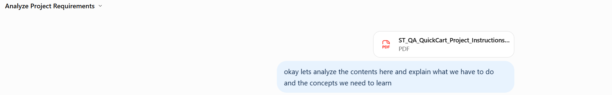
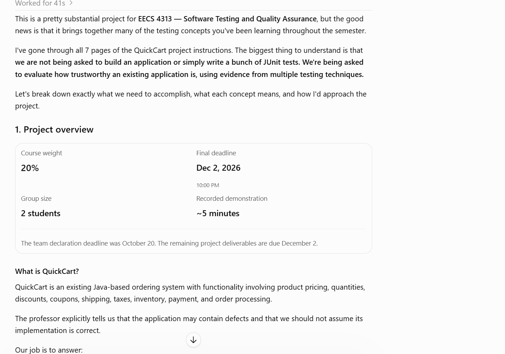
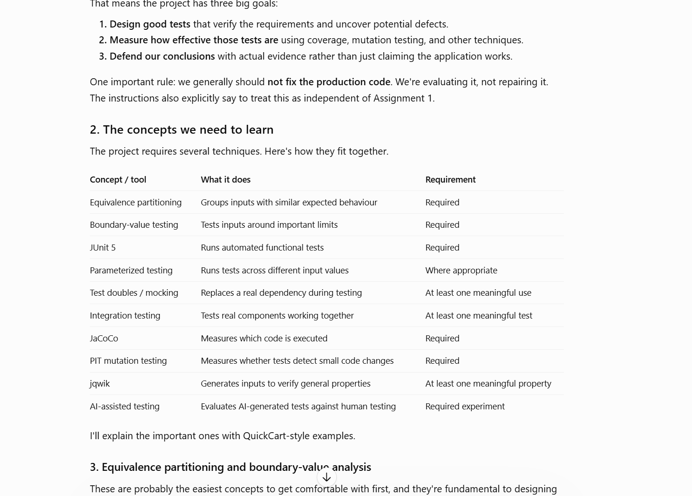
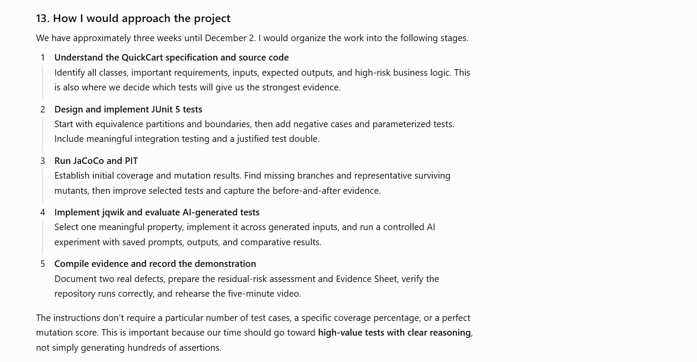
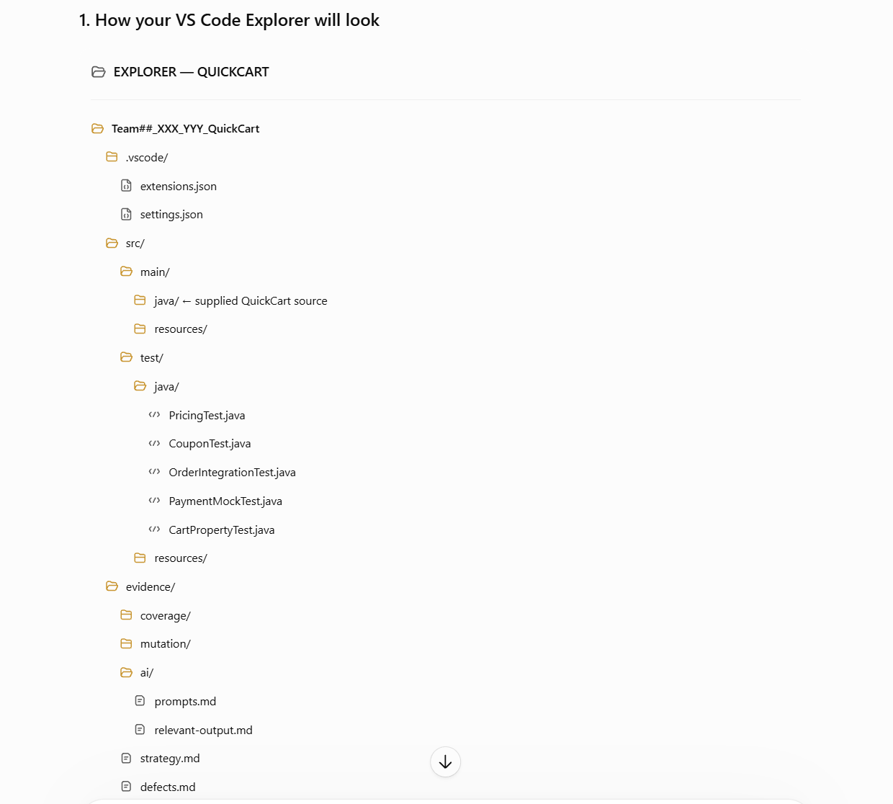
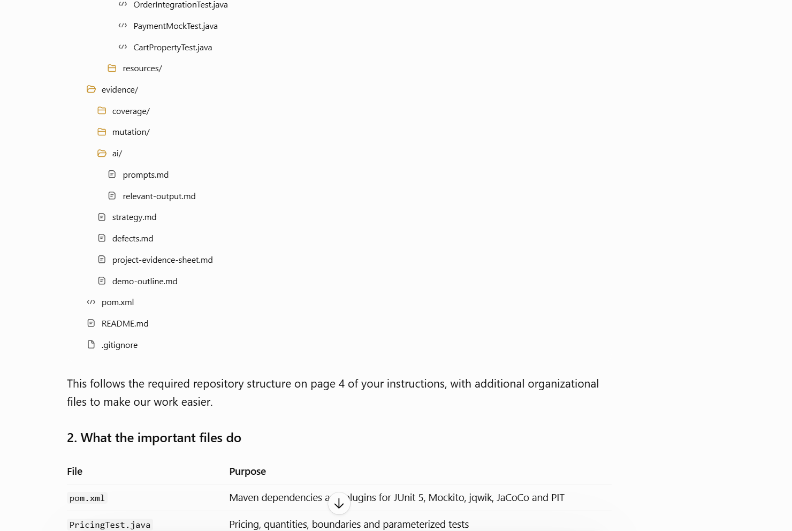
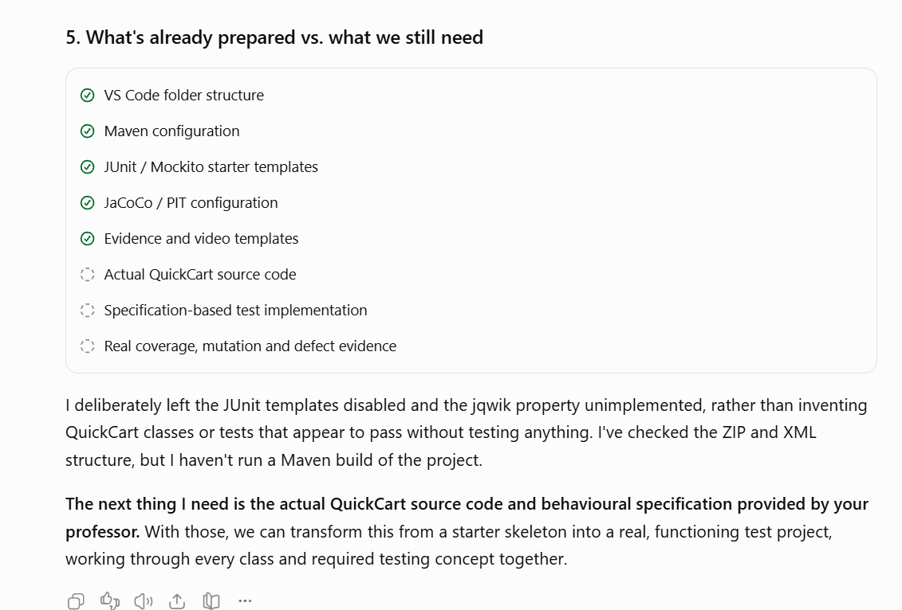

# Original supplied screenshots

These eight PNGs are the original image bytes attached by the user in the project conversation, saved without cropping, redrawing, recompression, or other edits. Their order matches the attachment order.

The screenshots are excerpts of the historical chat. They show the prompts and selected response sections; omitted sections and downloadable archive contents cannot be reconstructed from them. The original model version and conversation date are not visible. Written transcriptions are provided for search/accessibility alongside these primary image artifacts.

## P1: requirements analysis

## P2: proposed project skeleton

